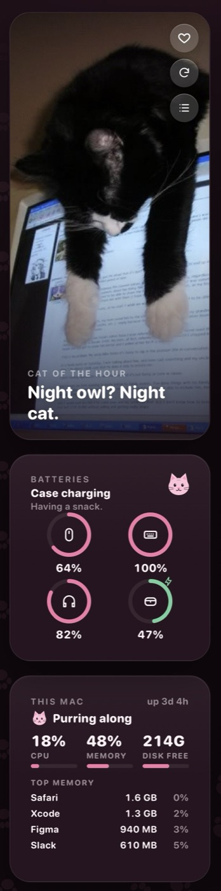
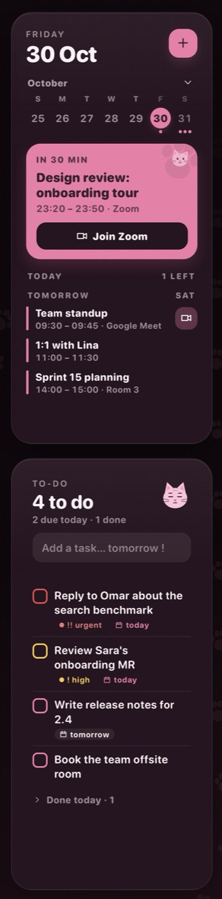
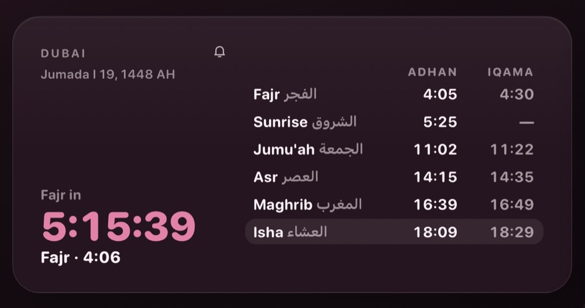
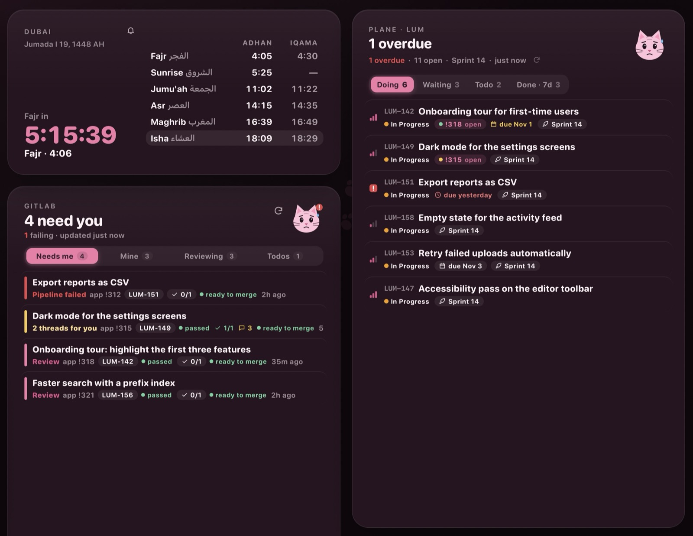
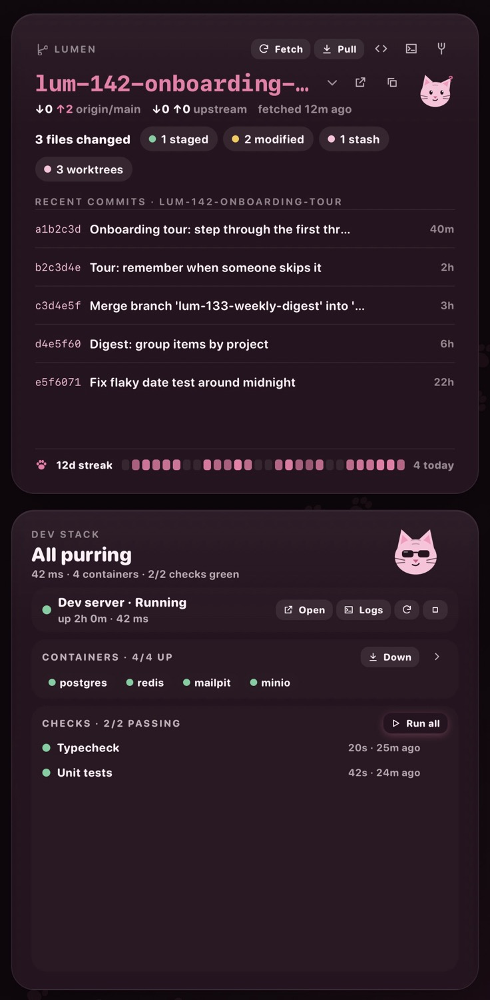
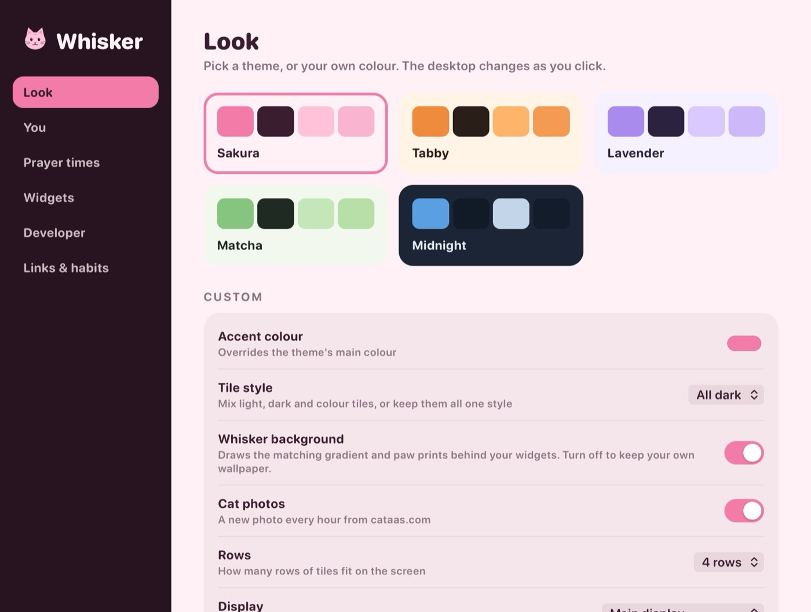

# Whisker

**Cat-themed, interactive widgets that live on your Mac's desktop.**
Your day at a glance and your dev work one click away, in a calm theme of your choice.

[**Download for macOS**](https://github.com/ialhejaili/whisker/releases/latest/download/Whisker.dmg) · macOS 14+ · Apple Silicon & Intel · signed & notarised · updates itself

All screenshots use made-up sample data from Whisker's demo mode.

## What it is

Whisker puts a grid of widgets on your desktop, behind your windows like a wallpaper. Unlike most desktop widgets, these aren't just for looking: tick off a to-do, join a meeting, approve a merge request, move a ticket, or start your dev server, right from the desk.

- **⌥ Space** brings the desk in front of your windows, and Esc sends it back.
- The **cat in the menu bar** lists what needs you right now, with a count.
- **Today** view (⌘T from the cat menu) gathers everything that needs you on one page.
- Every cat has moods: worried when a pipeline fails, asleep when your day is clear, proud when the list is done.

## Widgets

Turn widgets on or off, reorder them and drag them into place in **Settings › Widgets** or **Arrange Tiles** in the cat menu.

### For your day

<table>
<tr>
<td width="25%" valign="top"></td>
<td width="25%" valign="top"></td>
<td valign="top">

**Agenda.** Today and tomorrow from Apple Calendar, including Google and Exchange calendars you've added there. The next meeting gets a big card with a one-click **Join** for Zoom, Meet and Teams links. Tap a day for its full schedule, add events with **+**, and tick off dated reminders.

**To-do.** Type naturally: `call the bank tomorrow !` sets the due date and priority (`!` high, `!!` urgent). Overdue items go red, and the cat follows your progress.

**Prayer times.** The next prayer with a countdown, all five prayers with adhan and iqama times, and sunrise. Calculated on your Mac for your location: pick the method (Umm al-Qura, MWL, ISNA, Egypt, Karachi and more), set iqama offsets, and get an alert before each prayer.

**Batteries.** Your mouse, keyboard, AirPods and their case at a glance, with charging state.

**This Mac.** CPU, memory, disk and the apps using the most memory. Quit one from the list.

**Cat photo.** A new cute or funny cat every hour. Double-click to keep one in your favourites.

**Quick links.** The sites and apps you open all day, with their real icons.

</td>
</tr>
</table>

Also available: **Clock & greeting**, **Focus timer** (pomodoro with a sleepy cat on breaks), **Habits**, **Sticky note**, **Apple Reminders** and **Cat fact & dev tip**.

### For developers

**Review inbox (GitLab).** Merge requests that need you, ranked: failing pipelines and conflicts on yours, threads waiting for your reply, and reviews you've been asked for. Approve, merge (now or when the pipeline passes), retry a pipeline, read the job log and reply, without opening the browser. Tabs for your own MRs, reviews and GitLab todos.

**Plane tickets.** Your work items by Doing, Waiting (review and QA), Todo and Done, with due dates, cycles and priority. Change the state or priority, comment, or open the ticket. **Start branch** creates a local git branch (or a worktree) named after the ticket. Linked merge requests show on each ticket, and Whisker suggests moving a ticket once its MR is merged.

<table>
<tr>
<td width="45%" valign="top"></td>
<td valign="top">

**Repo.** Your checkout at a glance: branch, ahead/behind, changed files, stashes and recent commits. Fetch, pull, switch or create branches, stash and pop, and clean up merged worktrees. A row of paw prints shows your commits per day, and your streak.

**Dev stack & checks.** Start, stop and restart your dev server and see its log. It shows as running only when the app really answers. Bring Docker Compose up or down, watch each container, and run your checks (typecheck, tests, migrations) with a pass/fail history. A notification tells you when a check fails or the server goes down.

</td>
</tr>
</table>

The developer widgets are optional: they stay out of the way until you add your repo, GitLab and Plane details in **Settings › Developer**.

## Make it yours

<table>
<tr>
<td></td>
<td></td>
</tr>
<tr>
<td align="center">Midnight</td>
<td align="center">Matcha</td>
</tr>
</table>

Five themes (Sakura, Tabby, Lavender, Matcha, Midnight) or your own accent colour. Mixed, all-dark or all-light tiles, an optional matching background with wandering paw prints, the number of rows, and which display Whisker lives on.

Export your settings to move them to another Mac (your Plane token stays out of the file unless you include it).

## Install

1. [Download Whisker](https://github.com/ialhejaili/whisker/releases/latest/download/Whisker.dmg), open it, and drag **Whisker** into **Applications**.
2. Open Whisker. Settings opens on first launch: pick a theme and set your location for prayer times.
3. macOS asks once each for Location, Calendar, Reminders and notifications. Allow the ones you want.

Turn on **Open at Login** in the cat menu to have your desk ready every morning.

### Developer widgets

| Widget | What it needs |
|---|---|
| Review inbox | [`glab`](https://gitlab.com/gitlab-org/cli), signed in: `brew install glab && glab auth login` |
| Plane tickets | Your Plane address, workspace and a personal access token |
| Repo | The folder of your git checkout |
| Dev stack | Your dev server command and URL; Docker for containers |

The data scripts use the `python3` that comes with Apple's Command Line Tools. macOS offers to install them the first time if needed.

## Updates

Whisker checks for a new version once a day. When there is one, you get a notification and an **Install** item under the cat in the menu bar. One click updates and relaunches it, and your settings and permissions stay as they are. You can also choose **Check for Updates…** any time.

## Your data stays on your Mac

- Settings, to-dos, notes and favourites are stored in `~/Library/Application Support/Whisker`. Nothing is sent anywhere.
- Whisker only talks to services you set up yourself (your GitLab, your Plane), plus cataas.com for cat photos and each quick link's site for its icon.
- Widget pages load nothing from the internet. Cat photos and icons are fetched, checked and re-encoded by Whisker itself, and shown as local images.
- Updates are signed: Whisker only installs updates signed by its developer.

---

Made with care (and cats) by Ibtihal Alhejaili. This repository hosts Whisker's releases.

