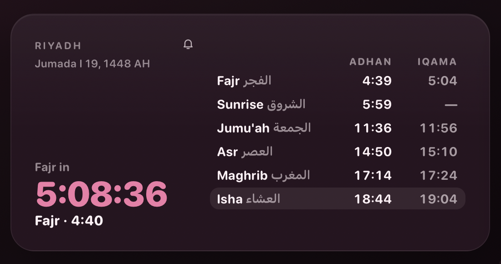
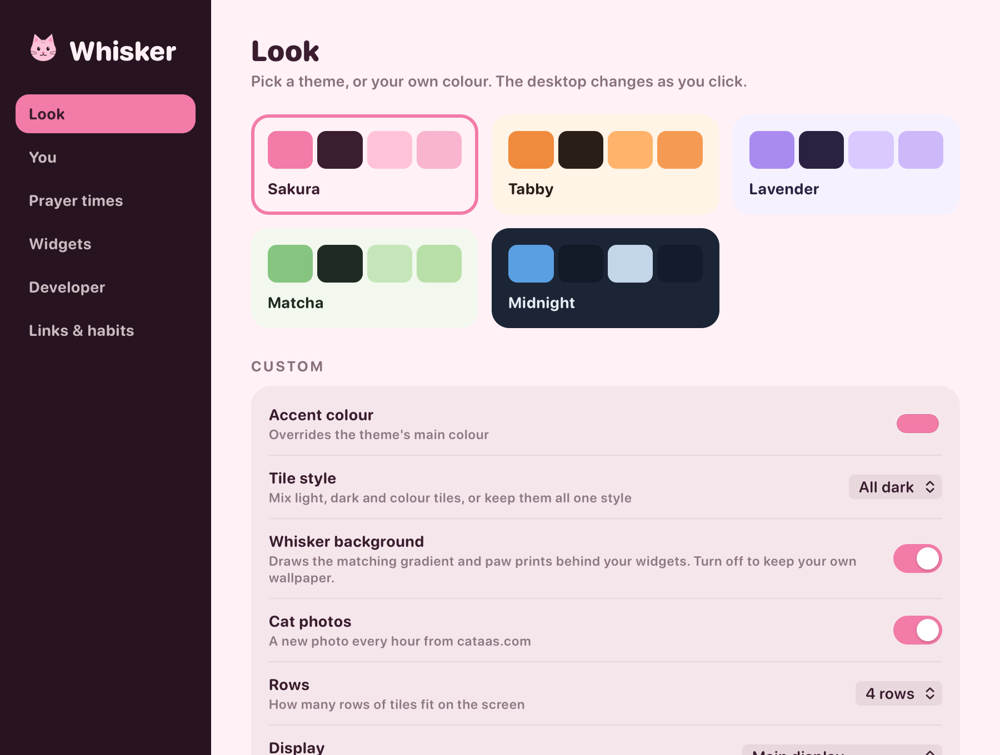

# Whisker

### Your day and your dev work, right on your Mac's desktop.

Interactive widgets with a calm, cat-themed design. Join a meeting, tick off a to-do, 
approve a merge request or open a ticket without leaving the desk.

 

 

Every screenshot uses made-up sample data from Whisker's demo mode.

 

## At a glance

<table>
<tr>
<td width="33%" valign="top">

**For your day**

- Agenda from Apple Calendar, with one-click Join
- To-dos you can type naturally
- Prayer times with iqama, for your city
- Batteries, your Mac, quick links
- A new cat photo every hour

</td>
<td width="33%" valign="top">

**For your dev work**

- GitLab review inbox: approve, merge, reply
- Plane tickets: create, move, comment
- Create merge requests in one step
- Your repo, branches and worktrees
- Dev server, containers and checks

</td>
<td width="33%" valign="top">

**Made for the Mac**

- Lives on the desktop, behind your windows
- Or add single widgets next to your own
- <kbd>⌥ Space</kbd> brings it to the front
- A menu-bar cat lists what needs you
- Five themes, or your own colour
- Updates itself, data stays on your Mac

</td>
</tr>
</table>

 

## From ticket to merge request

Whisker links your Plane tickets, your repo and GitLab, so every ticket you're working on shows its next step.

<table>
<tr>
<td width="50%" valign="top"></td>
<td width="50%" valign="top"></td>
</tr>
<tr>
<td valign="top"><b>1. Create the ticket.</b> Press <b>+</b> on the Plane tile: title, description, state, priority, labels and due date, assigned to you. You can also turn a to-do or a failing check into a ticket, already filled in.</td>
<td valign="top"><b>3. Open the merge request.</b> The title and description come from the ticket and your commits. Whisker pushes the branch if needed, opens the MR, and offers to move the ticket to review.</td>
</tr>
</table>

**2. Start the branch.** One click creates a branch (or a worktree) named after the ticket. 
**4. Merge.** Approve and merge from the review inbox. Once it's merged, Whisker suggests the ticket's next state.

You choose which states those are in **Settings › Developer**, to match your team's workflow.

 

## Widgets for your Mac's desktop

Want just one or two? Whisker's widgets are in the macOS widget gallery too, so you can place them next to your own. Right-click the desktop, choose **Edit Widgets…** and search for Whisker.

**Up next**, **Prayer times**, **Needs you**, **Agenda**, **To-do**, **Plane tickets**, **Review inbox** and **Cat of the hour**, in the sizes macOS offers. They follow your theme, countdowns tick live, and a click opens the ticket, the merge request, the meeting or Whisker itself. Whisker needs to be running to keep them up to date.

 

## Keyboard

| Keys | From any app |
|---|---|
| <kbd>⌥ Space</kbd> | Show or hide the desk |
| <kbd>⌥ ⇧ Space</kbd> | Today: everything that needs you |
| <kbd>⌃ ⌥ H</kbd> | Hide or show the widgets |

On the desk: <kbd>T</kbd> Today, <kbd>A</kbd> arrange tiles, <kbd>?</kbd> every shortcut, <kbd>Esc</kbd> back. Pick another desk shortcut in **Settings › Look**.

 

## Widgets on the desk

Turn widgets on or off and reorder them in **Settings › Widgets**, or drag them into place with **Arrange Tiles** in the menu-bar cat.

### For developers

| | |
|---|---|
| **Review inbox** (GitLab) | The merge requests that need you, most urgent first: failing pipelines and conflicts on yours, replies you owe, reviews you've been asked for. Approve, merge now or when the pipeline passes, retry a pipeline, read the job log and reply to threads. |
| **Plane tickets** | Your work items by Doing, Waiting, Todo and Done, with due dates, cycles and priority. Create tickets, change state or priority, comment, and see each ticket's branch and merge request. |

<table>
<tr>
<td width="40%" valign="top"></td>
<td valign="top">

**Repo.** Branch, ahead and behind, changed files, stashes and recent commits, plus the branch's ticket and merge request. Fetch, pull, switch or create branches, stash, create merge requests and clean up old worktrees. A strip of paw prints counts your commits per day.

**Dev stack & checks.** Start, stop and restart your dev server and read its log. It only shows as running when the app really answers. Bring Docker Compose up or down, watch each container, and run your checks with a pass/fail history. You get a notification when something breaks.

</td>
</tr>
</table>

### For your day

<table>
<tr>
<td width="22%" valign="top"></td>
<td width="22%" valign="top"></td>
<td valign="top">

**Agenda.** Today and tomorrow from Apple Calendar, including the Google and Exchange calendars you've added there. The next meeting gets a big card with **Join** for Zoom, Meet and Teams. Open any day, add events, and tick off dated reminders.

**To-do.** Type naturally: `call the bank tomorrow !` sets the due date and priority (`!` high, `!!` urgent). Turn any to-do into a Plane ticket.

**Batteries.** Mouse, keyboard, AirPods and their case, with charging state.

**This Mac.** CPU, memory, disk, and the apps using the most memory.

**Cat photo.** A new cat every hour. Every photo is checked on your Mac to make sure it really is a cat, and not a meme or a dog. Keep favourites, or hide one for good.

**Quick links.** The sites you open all day, with their real icons.

</td>
</tr>
</table>

**Prayer times.** The next prayer with a countdown, all five prayers with adhan and iqama times, and sunrise. Calculated on your Mac for your city with the method you choose (Umm al-Qura, Muslim World League, ISNA, Egypt, Karachi, Dubai, Kuwait, Qatar, Singapore or Turkey). Set iqama offsets and get an alert before each prayer.

Also available: **Clock & greeting**, **Focus timer**, **Habits**, **Sticky note**, **Apple Reminders** and **Cat fact & dev tip**.

 

## Make it yours

<table>
<tr>
<td width="33%"></td>
<td width="33%"></td>
<td width="33%"></td>
</tr>
<tr>
<td align="center"><b>Midnight</b></td>
<td align="center"><b>Matcha</b></td>
<td align="center"><b>Lavender</b></td>
</tr>
</table>

- Five themes (Sakura, Tabby, Lavender, Matcha, Midnight) or your own accent colour
- Mixed, all-dark or all-light tiles
- A matching background with wandering paw prints, or your own wallpaper
- How many rows of tiles, and which display
- A shortcut or hot corner to bring the desk forward
- Cover your desktop files with the background, or keep them in view
- Export your settings to another Mac

 

 

## Get started

1. **[Download Whisker](https://github.com/ialhejaili/whisker/releases/latest/download/Whisker.dmg)**, open it, and drag Whisker into **Applications**.
2. **Open Whisker.** Settings opens on first launch: pick a theme and your city.
3. **Allow what you want.** macOS asks once each for Location, Calendar, Reminders and notifications.

Then turn on **Open at Login** in the menu-bar cat, and your desk is ready every morning.

<b>Setting up the developer widgets</b>

 

They stay out of the way until you fill in **Settings › Developer**.

| Widget | What it needs |
|---|---|
| Review inbox | The GitLab CLI, signed in: `brew install glab && glab auth login` |
| Plane tickets | Your Plane address, workspace and a personal access token |
| Repo | The folder of your git checkout |
| Dev stack | Your dev server command and URL; Docker for containers |

The data scripts use `python3` from Apple's Command Line Tools. macOS offers to install them the first time, if needed.

 

## Updates and privacy

- **Automatic updates.** Whisker checks once a day. When a new version is out, you get a notification and an **Install** item in the menu-bar cat. Your settings and permissions stay. Every update is signed and checked before it installs.
- **Your data stays on your Mac.** Settings, to-dos and favourites live in `~/Library/Application Support/Whisker`. Nothing is sent anywhere.
- **Only the services you set up.** Whisker talks to your own GitLab and Plane, to cataas.com for cat photos, and to each quick link's site for its icon.
- **Nothing loads from the web.** Widgets can't load anything from the internet. Photos and icons are downloaded, checked and re-encoded by Whisker, then shown as local images.

 

---

Made with care, and cats, by Ibtihal Alhejaili. This repository hosts Whisker's releases.

