

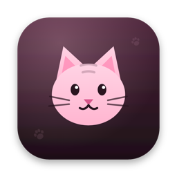

# Whisker

### Your whole dev workflow, live on your Mac's desktop.

Plane tickets, GitLab merge requests, your branches and your local stack, in widgets that do the work. 
See what needs you, act on it in one click, and get a notification the moment something changes.

 

 

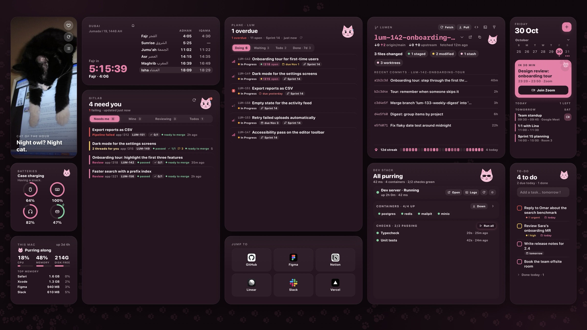

<table>
<tr>
<td width="33%"><a href="#pick-your-look">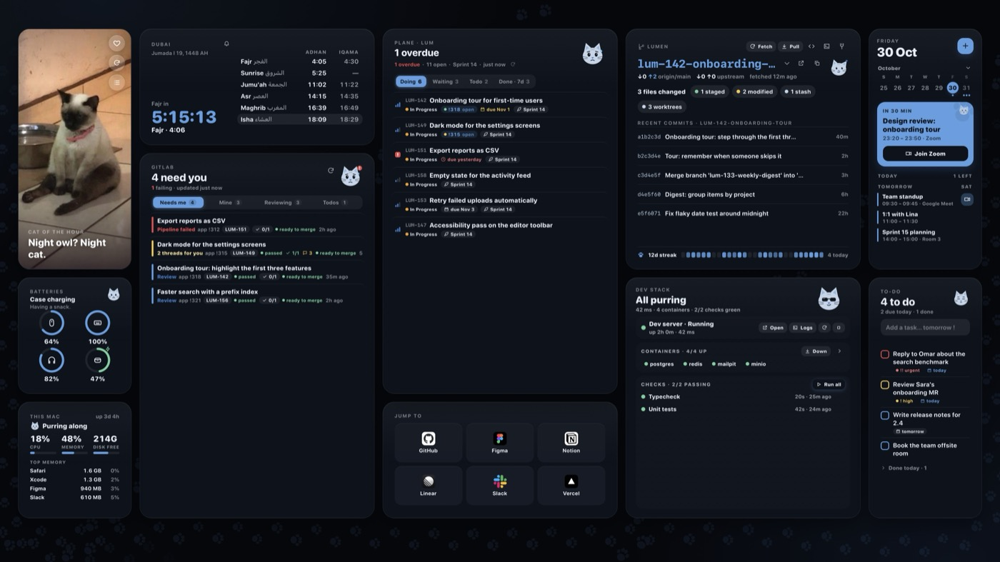</a></td>
<td width="33%"><a href="#pick-your-look">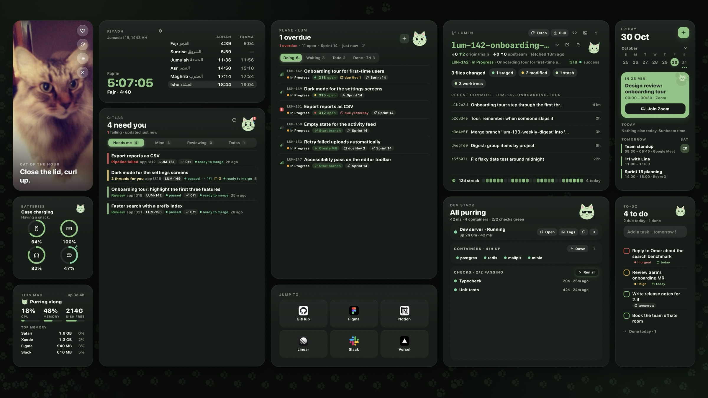</a></td>
<td width="33%"><a href="#pick-your-look">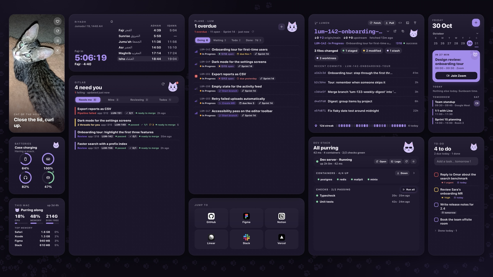</a></td>
</tr>
<tr>
<td align="center"><b>Midnight</b></td>
<td align="center"><b>Matcha</b></td>
<td align="center"><b>Lavender</b></td>
</tr>
</table>

Five themes, or your own colour. Every screenshot uses made-up sample data from Whisker's demo mode.

 

## Stop switching. Start shipping.

A normal day: check Plane for your tickets, open GitLab to see if your pipeline passed, hunt for the review comment someone left, switch to the terminal to start the app, run the migrations, then go back to Plane to move the ticket.

Whisker puts all of it on your desktop, behind your windows, one glance away.

<table>
<tr>
<td width="25%" valign="top">

**See it**

What needs you, from every tool, sorted by what's most urgent.

</td>
<td width="25%" valign="top">

**Act on it**

Move tickets, merge, reply, run your app, all from the widget itself.

</td>
<td width="25%" valign="top">

**Hear about it**

A notification when a pipeline fails, someone comments or mentions you.

</td>
<td width="25%" valign="top">

**Keep it local**

Your own sign-ins, your own servers. Nothing goes through anyone else.

</td>
</tr>
</table>

 

## Your tickets, fully in hand

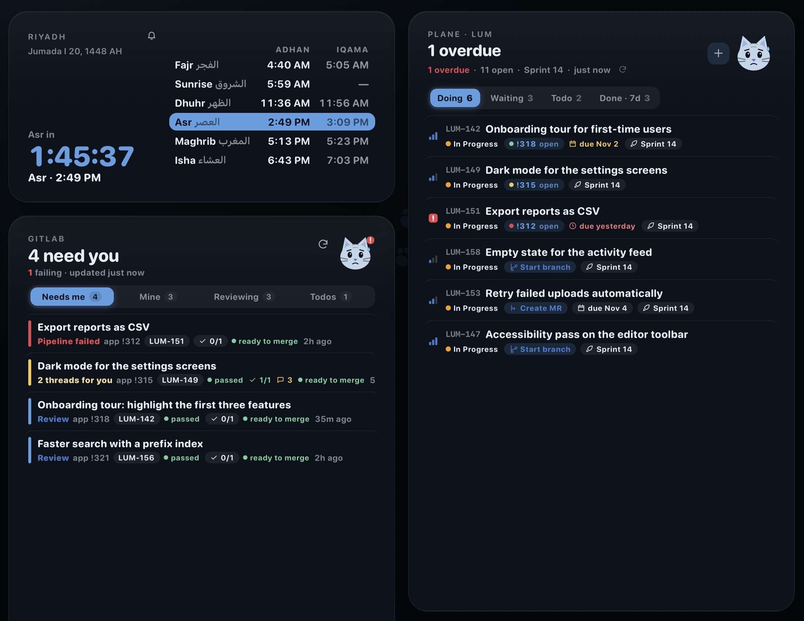

Every Plane ticket assigned to you, sorted into **Doing**, **Waiting**, **Todo** and **Done**, with due dates, cycles and priority.

- **Create** tickets with title, description, state, priority, labels and due date, or turn a to-do or a failing check into one
- **Read** the full description and every comment without opening Plane
- **Move** a ticket to its next state, or change its priority, in one click
- **Comment** right from the ticket's panel
- **See its code:** each ticket shows its branch and merge request, and offers the next step: *Start branch* or *Create MR*

 

## Merge requests that don't wait on you

The GitLab **Review inbox** lists every merge request that needs you, most urgent first.

- **Pipeline problems up front:** failing pipelines on your MRs come first. Read the job log, retry the pipeline or a single job
- **Unresolved threads, counted:** see which MRs have open threads and which replies you owe. Reply and resolve without leaving the panel
- **Review and merge:** approve, merge now or when the pipeline passes, rebase, mark as draft or ready
- **Conflicts and readiness** at a glance, for your MRs and the ones you review

 

## Notifications that keep you ahead

Whisker watches GitLab and Plane for you and tells you what changed, so you never have to check. Click a notification to open the MR or ticket.

| On your merge requests | On Plane |
|---|---|
| Pipeline failed, or passed after failing | Someone moved one of your tickets |
| Someone approved it | Someone mentioned you on **any** ticket in your projects, in a comment or the description |
| It's ready to merge, or has conflicts | |
| A new comment or unresolved thread | |
| Someone else merged or closed it | |

Your own actions never notify you. Turn each kind on or off in **Settings › Developer**.

 

## Your repo and local stack, one click away

<table>
<tr>
<td width="40%" valign="top">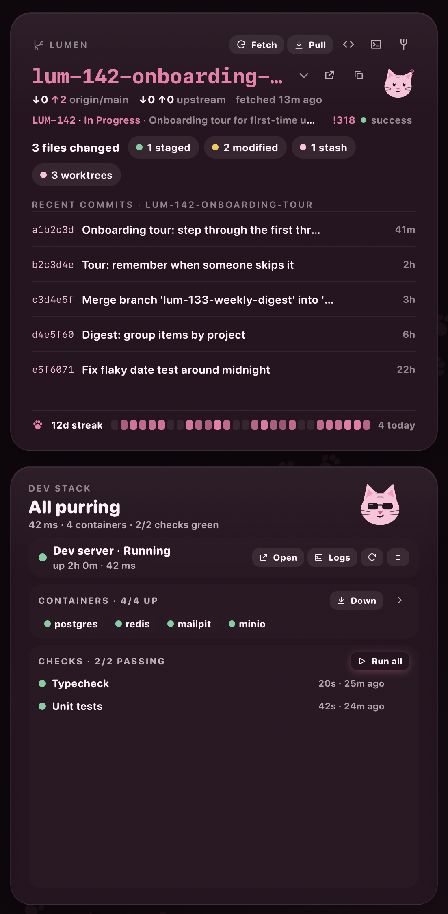</td>
<td valign="top">

**Branches without the terminal.**
- Branch, ahead and behind, changes, stashes and recent commits
- Fetch, pull, push, switch and create branches, stash and pop
- Every branch's ticket and merge request
- Clean up old worktrees in one go

**Your dev environment, under one button.**
- **Start, stop and restart** your dev server, and read its log
- **Docker Compose** up or down, with every container's health
- **Restart a container** or read its logs, one at a time
- **One-click commands:** add the ones you run every day, like *Run the app*, *Migrate the DB* or *Run tests*. Press one to run it in your repo, see pass or fail, and keep a history
- A notification when something breaks

</td>
</tr>
</table>

 

## From ticket to merged

<table>
<tr>
<td width="50%" valign="top">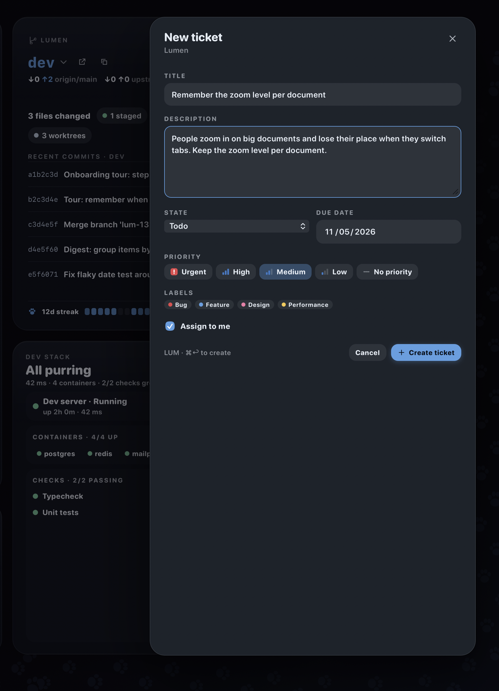</td>
<td width="50%" valign="top">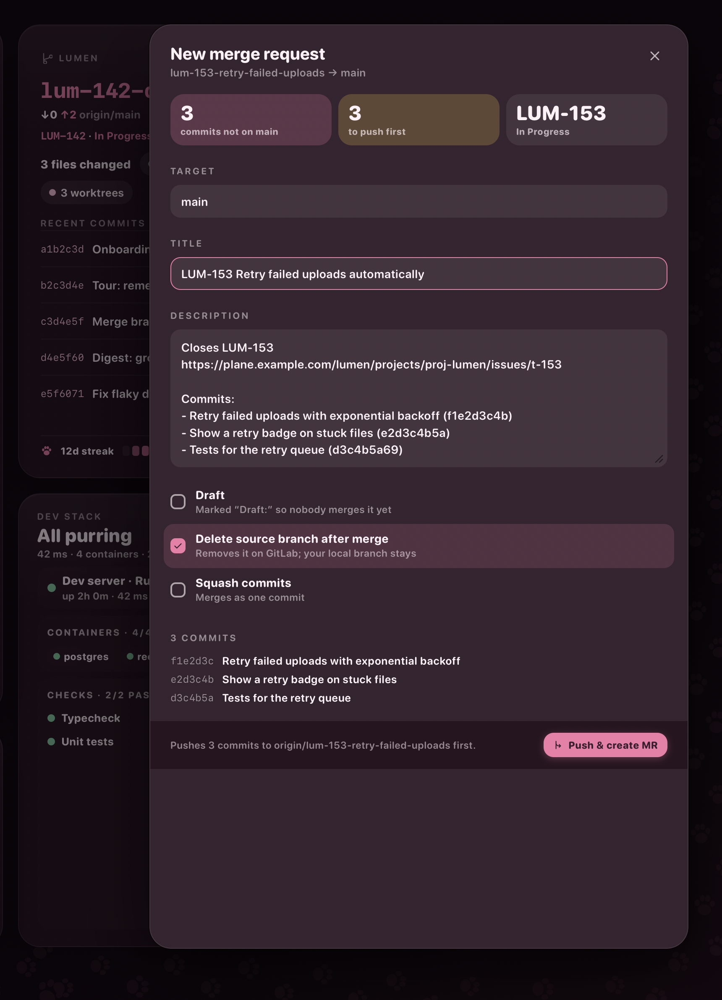</td>
</tr>
</table>

1. **Create the ticket** with **+** on the Plane tile.
2. **Start the branch** (or a worktree), named after the ticket.
3. **Open the merge request.** Title and description come from the ticket and your commits. Whisker pushes the branch and offers to move the ticket to review.
4. **Merge** from the Review inbox, and Whisker offers the ticket's next state.

 

## Pick your look

Five themes, or your own accent colour. Sakura is the pink one at the top; here are three more.

<b>Midnight</b>

<b>Matcha</b>

<b>Lavender</b>

Plus **Tabby**; mixed, all-dark or all-light tiles; and a matching background or your own wallpaper.

 

## Your day, on the same desk

<table>
<tr>
<td width="22%" valign="top">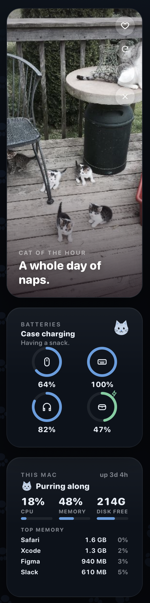</td>
<td width="22%" valign="top">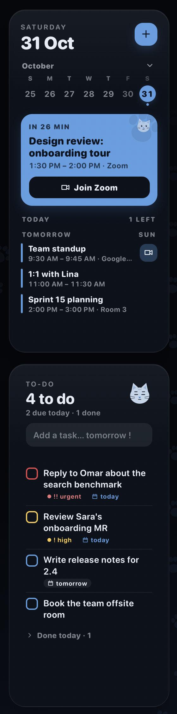</td>
<td valign="top">

- **Agenda** from Apple Calendar, with one-click **Join** for Zoom, Meet and Teams
- **To-do** you type naturally: `call the bank tomorrow !`
- **Prayer times** with adhan, iqama and a countdown, for your city
- **Batteries** for your mouse, keyboard and AirPods
- **This Mac**: CPU, memory and disk
- **Quick links** to the sites you open all day
- **A cat photo** every hour, checked to really be a cat

Also: Clock, Focus timer, Habits, Sticky note, Apple Reminders, and Cat fact & dev tip.

</td>
</tr>
</table>

 

## Or just the widgets you want

Every tile is also a macOS widget. Right-click your desktop, choose **Edit Widgets…** and search for Whisker.

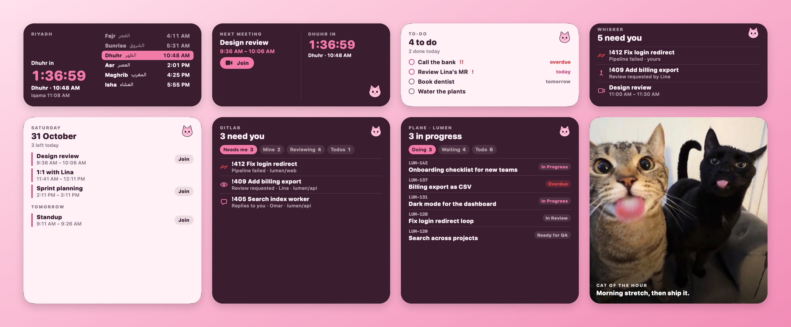

- **The same buttons as the desk:** approve, merge, move a ticket, start a branch, run a command
- **Anything that needs typing** opens just that panel, floating over your windows
- **Click a widget's header** to bring up the whole desk

| Keys | From any app |
|---|---|
| <kbd>⌥ Space</kbd> | Show or hide the desk |
| <kbd>⌥ ⇧ Space</kbd> | Today: everything that needs you |
| <kbd>⌃ ⌥ H</kbd> | Hide or show the widgets |

 

## Get started

1. **[Download Whisker](https://github.com/ialhejaili/whisker/releases/latest/download/Whisker.dmg)**, open it, and drag Whisker into **Applications**.
2. **Open Whisker.** Settings opens on first launch: pick a theme and your city.
3. **Allow what you want.** macOS asks once each for Location, Calendar, Reminders and notifications.

Then turn on **Open at Login** in the menu-bar cat. Connect your tools below; each takes about two minutes.

 

## Connect your tools

Everything is in **Settings › Developer** (open Settings from the menu-bar cat).

**First:** Apple's Command Line Tools (`xcode-select --install`) and [Homebrew](https://brew.sh).

### GitLab

Whisker uses the official GitLab CLI and its sign-in, so it never sees your GitLab token.

1. Install the CLI: `brew install glab`
2. Sign in:
   - **gitlab.com:** `glab auth login`, then choose **Web**.
   - **Your company's GitLab:** make a token in GitLab › avatar › **Edit profile** › **Access tokens**, with the **api** and **write_repository** scopes. Then run `glab auth login --hostname gitlab.example.com` and paste it.
3. Check it: `glab auth status`
4. In **Settings › Developer › GitLab**, fill in **Host** (like `gitlab.example.com`) and your **Username**.

### Plane

1. Make a token in Plane › avatar › **Profile settings** › **Personal access tokens** (older Plane: **Workspace settings** › **API tokens**). Copy it; Plane shows it once.
2. In **Settings › Developer › Plane**, fill in:
   - **Host**: `app.plane.so`, or your own Plane's address
   - **Workspace**: the slug in your Plane URLs (`my-team` in `app.plane.so/my-team/projects`)
   - **Project** (optional): one project's identifier, like `WORK`. Leave it empty to see every project you're in.
   - **API token**: the token from step 1. It's stored only on this Mac.
3. Optional: **After opening an MR** and **After the MR merges** name the states Whisker offers, like `In Review` and `Ready for QA`.

### Your repo and local stack

1. In **Git**, press **Choose folder…** and pick your checkout. Make sure `git push` works there from Terminal; Whisker uses your own git setup.
2. In **Dev server**, add the start command (like `pnpm dev`) and its URL.
3. Turn on **Docker Compose** if your project uses it.
4. In **Checks**, add your one-click commands, like `pnpm db:migrate` or `pnpm test`.

### Notifications

Each kind has its own switch in **Settings › Developer**. If you said no when macOS asked, turn them on in **System Settings › Notifications › Whisker**.

<b>If something doesn't show</b>

 

- **A tile says it's offline:** the server didn't answer. Whisker keeps the last list and tries again.
- **"glab isn't signed in":** run the command the tile shows, then press refresh.
- **Plane says "Token rejected":** the token expired or was deleted. Make a new one.
- **Plane refused access (403):** check the workspace slug, and that you're a member.
- **Mentions are a little late:** Plane has no mentions feed for tokens, so Whisker reads the newest comments on tickets that changed. They show within a couple of minutes.

 

## Private by design

- **Your data stays on your Mac** in `~/Library/Application Support/Whisker`.
- **Only the services you set up:** your GitLab and Plane, cataas.com for cat photos, and each quick link's site for its icon.
- **Nothing loads from the web** inside the widgets. Photos and icons are checked and re-encoded first.
- **Automatic updates,** signed and checked before they install. Your settings stay.

 

---

Made with care, and cats, by Ibtihal Alhejaili. This repository hosts Whisker's releases.

